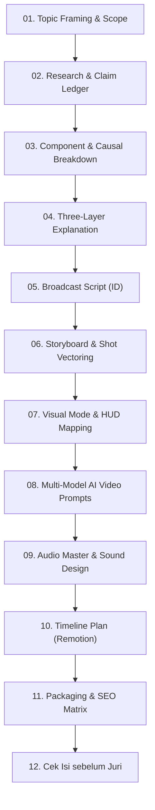

# HOW IT WORKS — AUDIRA TECH (Pro Motion Engine v2.0)

Turn any device, machine, industrial system, digital infrastructure, or physical mechanism into a broadcast-ready educational documentary video with photorealistic 3D mechanics and kinetic engineering HUD overlays.

> **Engine visual utama = Remotion + R3F** (default sejak 2026-11-17; style utama INNERWORKS / CIRCUITFORGE, lihat `.agents/brain/ENGINE_STYLE_SELECTION.md`). world3d (Three.js di HyperFrames, BRIEF `F:/AUDIRA-EPISODES/shared/world3d/BRIEF.md`) hanya bila pengguna memaksa. Model video AI (Kling, Runway, Luma, Wan) opsional, hanya untuk cutaway bila pengguna meminta.

Brand: **AUDIRA TECH**  
Series: **HOW IT WORKS**  
Tagline: **Understand the Technology Around You.**

---

## 🎯 1. Specs & Formats

| Attribute | Nilai (rule 07/09) |
|---|---|
| **Aspect Ratio** | 9:16 vertical (`1080x1920`) — 16:9 hanya bila pengguna meminta |
| **Durasi** | 80–90 detik, 190–210 kata, 8 scenes (s1–s8) |
| **Narration Speed** | 135–150 WPM |
| **Safe Zone** | Panel y 236, caption y 1300, bottom 380 clear, active-word bounce ≤ 1.04 |
| **Visual Core** | 3D Exploded View, Cutaway, X-Ray HUD, Macro, Physical Simulation, Microscopic |
| **Voiceover Engine** | `audira_generate_voiceover` (Cartesia TTS) |
| **Engine** | Remotion + R3F (default sejak 2026-11-17); world3d hanya bila pengguna memaksa |

---

## 🧠 2. Core Operational Principles

1. **Riset Mekanisme Nyata (No Hallucinations):** Jangan pernah mengarang komponen, diagram sirkuit, atau jalur fluida. Semua klaim mekanis harus bersandar pada dokumentasi resmi manufaktur, paten, atau literatur teknik.
2. **Show the Causal Chain:** Jangan sekadar memperlihatkan objek diam yang diputar. Tunjukkan hubungan sebab-akibat: *Trigger → Sensor/Input → Controller/Processor → Actuator/Physical Effect → System Output*.
3. **Motion Vector Continuity (Motion Doctrine):** Setiap perpindahan adegan (termasuk klip AI video bila dipakai) wajib mewarisi momentum kamera (vektor arah orbit, zoom, atau panning) agar penonton tidak mengalami disorientasi spasial (*spatial whiplash*).
4. **Cinematic 3D + HUD Overlays:** Pisahkan visual menjadi 2 layer:
   - **Base Video Layer:** Scene 3D Remotion + R3F (world3d hanya bila dipaksa). Klip model video AI (Kling, Runway, Luma Ray 2, Wan 2.1) opsional, tanpa teks generator mentah.
   - **Telemetry/HUD Layer:** Motion graphic overlay (HyperFrames / Remotion / After Effects) berupa garis penunjuk, dimensi CAD, nilai sensor live, dan teks keterangan.
5. **Anti-Slop Copywriting:** Larang frasa klise AI seperti *"Pernahkah Anda bertanya-tanya"*, *"Di era modern ini"*, *"Sebuah keajaiban teknologi"*. Awali langsung dengan fenomena fisik atau pertanyaan mekanis tajam.
6. **Master Clock Principle:** Audio voiceover adalah *master clock*. Visual, cutaways, dan HUD animations diselaraskan persis dengan timestamp pengucapan kata kunci audio.

---

## 🔄 3. Workflow Produksi 12 Fase

> **AUDIRA override (directive 00 menang).** 12 fase ini adalah isi kerja di dalam pipeline 11 tahap, bukan pipeline terpisah:
> Fase 01–02 → tahap 2 (Claim Ledger dicatat di `research/SOURCE_REGISTER.md`) · Fase 03–07 → tahap 4 (naskah, storyboard, manifest) · Fase 08 → hanya bila diminta · Fase 09 → tahap 6 (VO) dan 7 (SFX) · Fase 10 → tahap 7 · Fase 12 → cek isi sebelum juri tahap 8 · Fase 11 → tahap 10.
> Nilai resmi = `audira_style_memory` `record_score` di tahap 8. Satu-satunya gerbang acc = tahap 9.

### Fase 01 — Topic Framing & Scope
- Tentukan objek spesifik, generasi/model produk, atau prinsip universal.
- Format output: **9:16 vertical** (default). 16:9 hanya bila pengguna meminta.
- Rumuskan 1 pertanyaan sentral mekanis (Contoh: *"Bagaimana sensor optik kamera mengubah foton cahaya menjadi sinyal digital tanpa blur?"*).

### Fase 02 — Research & Claim Ledger
- Lakukan riset web bila koneksi aktif. Prioritaskan:
  1. *Primary Technical Sources:* Manual servis resmi, datasheet semikonduktor, whitepaper OEM, paten.
  2. *Academic & Standards Bodies:* IEEE, ISO, SAE, NASA, NIST.
  3. *Reputable Engineering Portals:* iFixit Teardowns, EE Times, Hackaday.
- Dokumentasikan temuan ke dalam **Claim Ledger** (`references/research-checklist.md`).

### Fase 03 — Component & Causal Breakdown
- Buat pemetaan hierarki:
  **Sistem → Subsistem → Komponen Kunci → Prinsip Fisika/Kimia/Elektronika → Output**
- Buat flowchart Mermaid untuk menggambarkan aliran materi, energi, atau data.

### Fase 04 — Three-Layer Explanation Design
Setiap mekanisme wajib dirumuskan dalam 3 layer pemahaman:
1. **Layer Analogis/Intuitif:** Perumpamaan sederhana untuk pemirsa awam.
2. **Layer Keteknikan Nyata:** Penjelasan eksak (hukum fisika, jenis material, frekuensi, voltase, tekanan).
3. **Layer Representasi Visual:** Bagaimana visual 3D & HUD mengilustrasikan aksi yang tak kasat mata.

### Fase 05 — Broadcast Scriptwriting (Bahasa Indonesia)
- Tulis naskah VO dengan metronom ketat (135–150 WPM untuk 9:16).
- Format penulisan naskah:
  - `[00:00 - 00:03]` **Hook:** Langsung ke misteri teknis atau aksi ekstrem.
  - `[00:04 - 00:15]` **Context (Inside Look):** Transisi dari eksterior ke interior mesin.
  - `[00:16 - 00:45]` **Main Development (Core Mechanism):** Urutan rantai sebab-akibat komponen.
  - `[00:46 - 01:10]` **Explanation (The Critical Engineering Genius):** Solusi pintar insinyur mengatasi kendala fisik (panas, gesekan, latensi).
  - `[01:11 - 01:25]` **Visual Payoff:** Mekanisme lengkap bekerja dan dampak teknologinya.
  - `[01:26 - 01:30]` **Outro:** Penutup tajam AUDIRA TECH + outro card AUDIRA.

### Fase 06 — Storyboard & Shot Vectoring (Motion Doctrine)
- Bagi naskah menjadi adegan berdurasi 4–8 detik per klip.
- Cantumkan **Exit Camera Vector** pada Scene N dan pasangkan dengan **Entry Camera Vector** pada Scene N+1 (`references/camera-motion-doctrine.md`).
- Hindari lompatan shot tanpa jangkar visual kontinuitas (*spatial anchor*).

### Fase 07 — Visual Mode & HUD Mapping
Pilih visual mode per adegan dari `references/visual-modes.md`:
- `Exploded View` (komponen terurai di udara)
- `Cutaway / Cross-Section` (casing transparan / terbelah)
- `Macro Mechanism` (gerigi berputar, fluida mengalir, katup membuka)
- `Microscopic / Electron Level` (aliran elektron semikonduktor, foton)
- `Scientific Simulation` (heat map termal, garis medan magnetik, stress tensor)
- Rancang **HUD Elements** (`references/hud-technical-overlays.md`): Leader lines, caliper CAD, label teks neon, gauge RPM/voltase.

### Fase 08 — Multi-Model AI Video Prompt Generation (opsional)
Fase ini opsional: visual utama dibangun di Remotion + R3F. Tulis prompt AI video hanya bila pengguna meminta klip model video.
Tulis prompt video mandiri (*standalone*) yang kompatibel dengan model video terkini (`references/ai-video-engines.md`):
- **Kling 1.5/2.0** (Camera parameter tokens, lighting, high mechanical fidelity)
- **Runway Gen-3 Alpha / Gen-4** (Camera controls: Pan, Tilt, Zoom, FPV)
- **Luma Dream Machine / Ray 2** (Physically based lighting, organic metallic motion)
- **Wan 2.1 / Hailuo Minimax** (Complex kinematic motions)
- *Prompt Structure:* `[Subject & Mechanical State] + [Action & Causal Movement] + [Camera Movement & Lens Focal Length] + [Environment & Lighting (Studio Rim Lighting, Octane 3D Look)] + [Negative Constraints]`

### Fase 09 — Voice & Audio Engineering
- Gunakan tool MCP `audira_generate_voiceover` bila tersedia, atau format prompt audio Cartesia TTS.
- Susun Sound Design Matrix:
  - **Foley:** Suara logam beradu, servo motorik mendesing, klik relay mekanik, desis pneumatik.
  - **Sci-Fi / UI SFX:** Bass drops saat cutaway, digital data pulses saat HUD menyala, whoosh berarah saat kamera orbit.
  - **Music:** Industrial tech, minimalist synth pulse, cinematic ambient drone.

### Fase 10 — Timeline & Compositing Plan (Remotion default)
- Susun spesifikasi timeline compositing:
  - Scene 3D Remotion + R3F atau klip video bila diminta (layer 0).
  - Web HUD overlays / SVG leader lines (layer 1).
  - Kinetic typography captions (layer 2).
  - Sound cues (audio layer).
- Gunakan `audira_project_layout` (action `add_episode`; `world3d` hanya bila dipaksa) untuk scaffold project (bukan `scaffold_hyperframes.py` yang melewati layout/gerbang).

### Fase 11 — Packaging, SEO & Multi-Platform Social Captions (Default di Chat)
Wajib membuat berkas `SOCIAL_CAPTIONS.md` di folder episode dan **MENAMPILKAN LANGSUNG** teks caption siap pakai di pesan respons akhir chat untuk **6 platform** (termasuk Threads) tanpa menunggu diminta:
1. **TikTok:** Hook sains mengejutkan, teks sampul (cover text), pinned comment rujukan ilmiah resmi, dan minimal 3 hashtag.
2. **Instagram Reels:** Rangkuman 5 poin kausalitas mekanis terstruktur, audio cue, prompt diskusi komentar, dan minimal 3 hashtag.
3. **YouTube Shorts:** 3 variasi judul high-CTR (<100 karakter), deskripsi lengkap + timestamp chapters + minimal 3 hashtag, YouTube Tags (<500 karakter), pinned comment, dan rekomendasi thumbnail.
4. **Facebook (Reels & Trending Feeds):** Storytelling naratif bernada percakapan, analogi logis, pemicu diskusi interaktif, dan minimal 3 hashtag.
5. **X (Twitter):** Format cuitan tunggal atau pembuka utas (thread) padat fakta (<=280 karakter termasuk hashtag) dengan daya retweet tinggi dan minimal 1 hashtag.
6. **Threads:** Post pembuka + utas pendek, tiap post maks 500 karakter, minimal 1 topic tag.

Wajib juga di `SOCIAL_CAPTIONS.md`: `## Jadwal Upload (WIB)` (satu baris per platform: hari dan jam) dan `## Label Konten AI` (TikTok "AI-generated content", YouTube "Altered or synthetic content", Meta "AI info").

Sebelum selesai, jalankan `audira_validate_social_captions` sampai hasilnya `ok: true`.

### Fase 12 — Cek Isi (bukan gerbang)
Daftar cek tambahan sebelum juri; nilai resmi tetap `record_score` (tahap 8). Skor 1–10:
1. **Scientific Integrity (1-10):** Apakah prinsip mekanis benar dan diverifikasi?
2. **Visual Continuity (1-10):** Apakah vektor kamera berkesinambungan?
3. **Audio-Pacing Sync (1-10):** Apakah durasi VO cocok dengan timecode adegan?
4. **Anti-Slop Compliance (1-10):** Apakah naskah bebas dari klise AI?
5. **HUD Compositing Feasibility (1-10):** Apakah overlay teks berada dalam safe-zone?
- Status akhir: **PASS** (siap produksi), **REVIEW** (revisi minor), **FAIL** (klaim teknis salah/visual menyimpang).

---

## 🛠️ 4. Toolkit Scripts (`scripts/`)

Skill ini dilengkapi utilitas otomasi Python di folder `scripts/`:

| Script | Fungsi |
|---|---|
| `orchestrate_episode.py` | **Master Pipeline Runner:** Menjalankan audit naskah, generate prompt multi-engine, align subtitle, scaffold HyperFrames, dan ekspor timeline NLE dalam 1 langkah. **Jangan dipakai untuk episode AUDIRA** (memanggil `scaffold_hyperframes.py`, melewati layout dan gerbang); jalankan script lain satu per satu. |
| `generate_prompts.py` | Mengonversi scene definitions menjadi prompt siap pakai untuk Kling, Runway, Luma, dan Wan 2.1. |
| `align_captions.py` | Membuat subtitle dinamis sinkron kata demi kata (WebVTT, SRT, dan Kinetic JSON). |
| `scaffold_hyperframes.py` | Membuat boilerplate project HyperFrames lengkap dengan HUD overlays dan timeline konfigurasi. **Jangan dipakai untuk episode AUDIRA**; scaffold lewat `audira_project_layout`. |
| `export_timeline.py` | Mengekspor storyboard ke format DaVinci Resolve EDL, Final Cut Pro XML (FCPXML), dan timeline JSON. |
| `verify_episode.py` | Melakukan audit otomatis terhadap durasi naskah (WPM), rasio safe zone, dan penyaringan frasa klise AI (*Anti-Slop*). |

---

## 📂 5. Berkas Rujukan, Template & Contoh

- [`references/visual-modes.md`](file:///f:/AUDIRA-ALL-SKILL/.agents/skills/how-it-works-audira-tech/references/visual-modes.md) — 9 mode visual teknis & aturan akurasi mekanis.
- [`references/ai-video-engines.md`](file:///f:/AUDIRA-ALL-SKILL/.agents/skills/how-it-works-audira-tech/references/ai-video-engines.md) — Kamus sintaks prompt untuk Kling, Runway, Luma Ray 2, Wan 2.1.
- [`references/camera-motion-doctrine.md`](file:///f:/AUDIRA-ALL-SKILL/.agents/skills/how-it-works-audira-tech/references/camera-motion-doctrine.md) — Kontinuitas vektor kamera antar scene (*spatial anchoring*).
- [`references/hud-technical-overlays.md`](file:///f:/AUDIRA-ALL-SKILL/.agents/skills/how-it-works-audira-tech/references/hud-technical-overlays.md) — Desain overlay blueprint CAD, caliper, data gauge, dan leader lines.
- [`references/technical-lexicon-id.md`](file:///f:/AUDIRA-ALL-SKILL/.agents/skills/how-it-works-audira-tech/references/technical-lexicon-id.md) — Glosarium baku istilah teknik otomotif, semikonduktor, dan fluida.
- [`references/sound-design-palette.md`](file:///f:/AUDIRA-ALL-SKILL/.agents/skills/how-it-works-audira-tech/references/sound-design-palette.md) — Spektrum audio foley mekanikal, sub-bass drop, dan aturan ducking.
- [`references/research-checklist.md`](file:///f:/AUDIRA-ALL-SKILL/.agents/skills/how-it-works-audira-tech/references/research-checklist.md) — Hierarki sumber & ledger verifikasi fakta.
- [`templates/production-output-template.md`](file:///f:/AUDIRA-ALL-SKILL/.agents/skills/how-it-works-audira-tech/templates/production-output-template.md) — Template master deliverable lengkap 14 bagian.
- [`templates/hyperframes-scene-template.ts`](file:///f:/AUDIRA-ALL-SKILL/.agents/skills/how-it-works-audira-tech/templates/hyperframes-scene-template.ts) — Template kode komponen layer HUD di HyperFrames.
- [`templates/svg-hud-library.html`](file:///f:/AUDIRA-ALL-SKILL/.agents/skills/how-it-works-audira-tech/templates/svg-hud-library.html) — Galeri interaktif 8 komponen grafis HUD SVG & CSS animasi.
- [`templates/fcpxml-template.xml`](file:///f:/AUDIRA-ALL-SKILL/.agents/skills/how-it-works-audira-tech/templates/fcpxml-template.xml) — Struktur XML Final Cut Pro & DaVinci Resolve.
- [`examples/lidar-autonomous-car/`](file:///f:/AUDIRA-ALL-SKILL/.agents/skills/how-it-works-audira-tech/examples/lidar-autonomous-car/) — Contoh lengkap paket produksi standar emas episode LiDAR mobil otonom.

