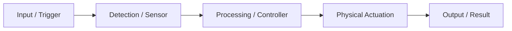

# HOW IT WORKS — AUDIRA TECH Production Master Package

Gunakan template ini untuk menghasilkan berkas produksi lengkap yang siap dieksekusi oleh tim 3D, editor HyperFrames/DaVinci, dan voice-over engineer.

---

## 01. Topic Framing & Technical Scope
- **Subject / Machine:** [Nama objek, misal: Sensor Kamera Smartphone CMOS]
- **Specific Model / Universal Standard:** [Model spesifik atau prinsip universal]
- **Category:** [Elektronika / Otomotif / Mekanikal / Infrastruktur / Aviasi]
- **Aspect Ratio:** [9:16 Vertical (1080x1920) / 16:9 Horizontal (3840x2160)]
- **Target Duration:** [Misal: 75 Detik / ~180 Kata]
- **Central Mechanical Question:** [Pertanyaan inti yang dijawab episode ini]

---

## 02. Research & Claim Ledger
| Claim ID | Mechanical / Scientific Fact | Primary Source / Standard | Confidence Level | Visual Treatment |
|---|---|---|---|---|
| **C-01** | ... | ... | HIGH / MED | ... |
| **C-02** | ... | ... | HIGH / MED | ... |

---

## 03. Component & System Hierarchy
**Sistem:** [Nama Sistem Utama]  
**Sub-Sistem:** [Sub-sistem Terkait]

| Komponen Kunci | Material & Dimensi Khas | Fungsi Mekanis / Elektronis | Interaksi dengan Bagian Lain |
|---|---|---|---|
| **01. ...** | ... | ... | ... |
| **02. ...** | ... | ... | ... |

### Causal Mechanism Flow (Mermaid):


---

## 04. Three-Layer Explanation
1. **Layer 1 (Analogis Awam):** [Penjelasan perumpamaan sederhana]
2. **Layer 2 (Fisika / Teknik Nyata):** [Penjelasan eksak hukum fisika/kimia/elektronika]
3. **Layer 3 (Koreografi Visual):** [Bagaimana kamera, 3D, dan HUD membedahnya]

---

## 05. Timecoded Broadcast Script (Indonesian)
*Target Pacing: ~140 Kata Per Menit (WPM)*

| Timecode | Naskah Narasi Voice-Over | Poin Inti Pembelajaran | Aksen Vokal & Emfasis |
|---|---|---|---|
| **00:00 - 00:08** | ... | Hook teknis | Nada penasaran, artikulasi tegas |
| **00:08 - 00:22** | ... | Cutaway ke interior | Pacing santai, membangun misteri |
| **00:22 - 00:45** | ... | Mekanisme utama rantai aksi | Pacing presisi, sinkron gerak |
| **00:45 - 01:05** | ... | Solusi kejeniusan insinyur | Nada kagum ilmiah |
| **01:05 - 01:20** | ... | Kesimpulan & Tagline AUDIRA TECH | Penutup mantap, berbobot |

---

## 06. Storyboard & Shot Vectoring (Motion Doctrine)

| Scene | Time | Voice-Over Beat | Visual Mode | Camera Entry & Motion | Camera Exit Vector | Graphic / HUD Overlay |
|---|---|---|---|---|---|---|
| **Sc-01** | 00:00 - 00:06 | ... | Real-World Op | Static to Dolly In | Push Forward (+30%) | Tech Badge: Object Model |
| **Sc-02** | 00:06 - 00:14 | ... | Exploded View | Push Forward (+30%) | Orbit Left (15°) | Leader Lines: 4 Core Parts |
| **Sc-03** | 00:14 - 00:24 | ... | Cutaway Internal | Orbit Left (15°) | Macro Probe In | Caliper CAD: Dimension check |

---

## 07. Visual Direction & Lighting Architecture
- **Look & Feel:** Photorealistic 3D Scientific Teardown, Octane Render look.
- **Lighting Setup:** Studio 3-point key lighting, dark slate background (`#0A0D14`), Electric Cyan rim highlight (`#00F2FE`).
- **Material Finishes:** PBR brushed titanium, tempered glass anti-reflective, matte polymer casing.
- **Spatial Anchoring:** Objek utama tetap terpusat di radius 30% layar tengah (koordinat 540, 960).

---

## 08. Multi-Model AI Video Prompts

### Scene 01: [Judul Scene]
- **Target Engine:** [Kling / Runway Gen-3 / Luma Ray 2 / Wan 2.1]
- **Aspect Ratio:** `--ar 9:16`
- **First Frame (I2V) Ref:** [Opsional path gambar master Midjourney]
- **Camera Movement:** [Contoh: Smooth orbital 45-degree rotation around center housing]
- **Full Prompt:**
  ```text
  [Prompt teks lengkap dan mandiri tanpa teks generator internal]
  ```
- **Negative Constraints:**
  ```text
  text, watermark, deformed geometry, low quality, cartoon, shaky camera, glitch
  ```

---

## 09. Voice-Over Audio Master (Cartesia TTS / Studio)
- **Engine:** Cartesia Sonic TTS (`natural-documentary-id`) atau Studio Narator.
- **Tone Direction:** Otoritatif, tenang, cerdas, tanpa intonasi berlebihan.
- **Clean Voice-Over Text:**
  ```text
  [Teks narasi bersih tanpa tanda kurung atau arah adegan untuk siap di-generate ke audio]
  ```

---

## 10. Sound Design & Foley Matrix
| Timecode | Audio Layer | SFX Description | Audio Cue & Emotional Intent |
|---|---|---|---|
| **00:06** | Foley Mechanical | Suara denting presisi logam casing terbuka | Menandai dimulainya exploded view |
| **00:14** | UI Sci-Fi | Suara digital pulse frekuensi tinggi (subtle) | Menandai munculnya leader lines HUD |
| **00:25** | Sub-Bass Drone | Deep ambient cinematic low rumble | Memberi bobot saat motor/mesin berputar |

---

## 11. HyperFrames Compositing & Timeline Specs
- **Timeline Resolution:** `1080x1920` (9:16) @ `60 FPS`
- **Layer 0 (Background):** AI Video Clips (mp4 / WebM VP9).
- **Layer 1 (Telemetry HUD):** SVG Caliper, Animated Leader Lines, Dynamic Metrics (via CSS stroke-dashoffset).
- **Layer 2 (Subtitles):** Kinetic Typography (Word-by-word highlight).
- **Audio Master Track:** `voiceover_master.wav` + `bgm_industrial_tech.mp3` + `sfx_track.wav`.

---

## 12. SEO, Thumbnails & Distribution Hooks
- **Judul Rekomendasi:** [Judul 1 (High CTR Curiosity)]
- **Judul Alternatif:** [Judul 2], [Judul 3]
- **Deskripsi Video:** [Deskripsi komprehensif + timestamps chapters]
- **Hashtags:** `#HowItWorks #AudiraTech #Teknologi #SainsPopuler #Engineering`
- **YouTube Tags (≤500 char):** `how it works, audira tech, cara kerja ..., teknologi ..., sains, animasi 3d, mesin`
- **Thumbnail Prompt (Midjourney / Flux):**
  ```text
  Cinematic 3D exploded view teardown of [Machine], glowing internal glowing parts, floating components, dramatic studio lighting, 8k resolution, photorealistic, octane render --ar 9:16
  ```

---

## 13. Quality Gate Audit (Scoring 1-10)
| Audit Dimension | Score (/10) | Status | Evaluator Notes |
|---|---:|:---:|---|
| **Scientific Integrity** | /10 | PASS / REVIEW | Verifikasi klaim berdasarkan sumber primer. |
| **Visual & Vector Continuity** | /10 | PASS / REVIEW | Momentum kamera berkesinambungan antar shot. |
| **Script Pacing & WPM** | /10 | PASS / REVIEW | Durasi kata sesuai dengan timecode scene. |
| **Anti-Slop Compliance** | /10 | PASS / REVIEW | Bebas klise AI, bahasa lugas dan berbobot. |
| **Safe Zone & HUD Feasibility**| /10 | PASS / REVIEW | Teks tidak tertutup antarmuka mobile apps. |

**Final Episode Verdict:** **PASS (Production Ready)**

