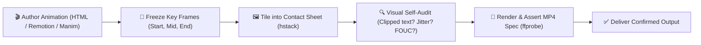

# Motion Skills: Deliver-and-Verify Loop & Motion Graphics System

> **56 specialized motion skills across 19 domain packs** with an embedded **Deliver-and-Verify Loop**. Teaches AI coding agents how to author professional motion graphics (kinetic type, charts, TikTok/Reels, 3D WebGL, explainers, overlays) and rigorously **inspect their own visual output** (freeze frame → tile contact sheet → assert MP4 spec) rather than hoping from a blind prompt.

---

## 🔄 1. The Deliver-and-Verify Loop

Motion graphics is the hardest domain for an AI agent to get right from a prompt alone: easing curves, safe zones, frame-accurate timing, brand palettes, and seamless loops.

This skill establishes the **Deliver-and-Verify Loop**:



---

## 🧰 2. Verify-Loop Toolkit (`scripts/`)

Small, deterministic, cross-platform tools included with this skill:

| Script (Node / Bash) | Tier | Fungsi & Output |
| :--- | :--- | :--- |
| `seek-shot.mjs` / `.sh` | **Light** (Standalone HTML) | Menjalankan harness `?t=N` pada file HTML dan mengambil screenshot deterministik pada detik tertentu (default: 0s, 1.5s, 3s). |
| `contact-sheet.mjs` / `.sh` | **All Tiers** | Menyatukan frame-frame still berdampingan secara horizontal (*3-up / N-up*) menjadi satu file `sheet.png` via ffmpeg untuk evaluasi visual 1 pandangan. |
| `probe-mp4.mjs` / `.sh` | **Heavy** (Remotion / Manim) | Membaca metadata biner langsung dari file MP4 (resolusi, codec, fps, durasi) dan menguji keabsahan kontrak (*contract assertion*). |
| `showcase-to-gif.mjs` | **Showcase** | Menjalankan Playwright headless, membekukan `gsap.globalTimeline`, merekam frame demi frame, dan memproduksi GIF berpalet optimal via ffmpeg. |

### Contoh Penggunaan Cepat

#### A. Light Tier — Standalone HTML (`?t=N` Harness)
```bash
# 1. Freeze detik 0, 1.5, dan 3
node .agents/skills/motion-skills/scripts/seek-shot.mjs anim.html 0 1.5 3

# 2. Satukan ke contact sheet
node .agents/skills/motion-skills/scripts/contact-sheet.mjs sheet.png frame-0.png frame-1.5.png frame-3.png

# 3. Inspeksi sheet.png: Apakah teks terpotong? Apakah transisi berada di posisi benar?
```

#### B. Heavy Tier — Remotion Programmatic Video
```bash
# 1. Render still frame awal, tengah, akhir dengan real props
npx remotion still Short out/f-start.png --frame=0 --props='{...}'
npx remotion still Short out/f-mid.png   --frame=45 --props='{...}'
npx remotion still Short out/f-end.png   --frame=90 --props='{...}'

# 2. Tile contact sheet
node .agents/skills/motion-skills/scripts/contact-sheet.mjs sheet.png out/f-start.png out/f-mid.png out/f-end.png

# 3. Render MP4 & uji spesifikasi
npx remotion render Short out/short.mp4 --props='{...}'
node .agents/skills/motion-skills/scripts/probe-mp4.mjs out/short.mp4 1080x1920 30
```

#### C. Heavy Tier — Manim Math Animation
```bash
# Render last frame & assert MP4
manim -s -ql scene.py MyScene
node .agents/skills/motion-skills/scripts/probe-mp4.mjs media/videos/scene/480p15/MyScene.mp4
```

---

## ⏱️ 3. The `?t=N` Seek Harness Contract

Setiap kali AI membuat animasi HTML mandiri (GSAP / Canvas / WebGL / CSS), AI **wajib menyematkan harness `?t=N`**:

```javascript
// Standar Seek Harness AUDIRA Motion
const urlParams = new URLSearchParams(window.location.search);
const seekTime = urlParams.get('t');

if (seekTime !== null) {
  // Mode Freeze / Audit: hentikan loop dan lompat ke detik yang diminta
  tl.pause();
  tl.seek(parseFloat(seekTime));
} else {
  // Mode Live: mainkan seperti biasa
  tl.play(0);
}
```

Aturan penting harness:
1. Tidak boleh ada `Date.now()`, `performance.now()`, atau `Math.random()` tanpa seed saat menggambar frame.
2. Setiap elemen visual adalah fungsi murni dari waktu *timeline* `t`.

---

## 📦 4. Taksonomi 19 Motion Graphics Packs (56 Skills)

Sistem `motion-skills` memetakan 19 paket spesialisasi untuk berbagai domain industri:

| # | Pack Name | Target Audiens | Cakupan Keahlian |
| :-: | :--- | :--- | :--- |
| 1 | **`tiktok-video-skills`** | TikTok / Reels / Shorts | Vertical 9:16, hooked intros, fast pacing, text beats. |
| 2 | **`text-message-video-skills`** | Text-message stories | Chat bubbles, typing bubbles, sound triggers, message pacing. |
| 3 | **`youtube-video-skills`** | YouTubers & Podcasters | Channel branding, chapters, lower-thirds, video openers. |
| 4 | **`ecommerce-video-skills`** | E-commerce & Retail | 3D product showcase, price callouts, discount ribbons, unboxing. |
| 5 | **`ad-video-skills`** | Marketers & Brands | High-conversion ad hooks, CTA cards, logo stingers. |
| 6 | **`data-animation-skills`** | Analysts & PMs | Animated bar charts, line graphs, donut meters, count-ups. |
| 7 | **`explainer-video-skills`** | Educators & Course Creators | Diagram workflows, whiteboard logic, step-by-step visualizers. |
| 8 | **`map-animation-skills`** | Vox-style Editorial | Geo-spatial paths, territory zoom, pin drops, travel routes. |
| 9 | **`web-animation-skills`** | Frontend Web Developers | GSAP scroll triggers, SVG morphing, Lottie, hover micro-interactions. |
| 10 | **`motion-design-skills`** | Motion Designers | Easing curves, kinetic rhythm, anticipatory squash & stretch. |
| 11 | **`kinetic-typography-skills`** | Typography Animators | Char-by-char stagger, mask reveals, whip pans, 3D text rotation. |
| 12 | **`freelance-motion-skills`** | Freelance Studios | Client delivery specs, review overlays, storyboard framing. |
| 13 | **`webgl-animation-skills`** | 3D / WebGL Developers | Three.js particle systems, GLSL vertex displacement, cyber shaders. |
| 14 | **`manim-skills`** | Math Animators | 3Blue1Brown style geometry, calculus visual proofs, LaTeX math motion. |
| 15 | **`generative-illustration-skills`** | Creative Coders | Algorithmic canvas patterns, noise fields, organic generative art. |
| 16 | **`javascript-animation-skills`** | Zero-Asset Animators | 100% canvas 2D code, mathematical synth sound generation, no media files. |
| 17 | **`lower-thirds-skills`** | Streamers & Video Editors | Transparent alpha channels (WebM VP9 alpha, Apple ProRes 4444). |
| 18 | **`b-roll-skills`** | Content Creators & Editors | B-Roll overlays matched to audio transcripts, kinetic topic cards. |
| 19 | **`talking-head-skills`** | Presenters & Educators | Avatar framing, lip-sync coordination, speaker-centering motion. |

---

## 🔗 5. Sinergi dengan Ekosistem AUDIRA

`motion-skills` melengkapi skill video dan motion yang sudah ada di AUDIRA:
- **`hyperframes`**: Framework utama HTML-to-video deterministik.
- **`motion-doctrine`**: Hukum kontinuitas vektor kamera (*vector ledger*).
- **`cut-the-curve`**: Katalog transisi antar-adegan (*waterfall, implode, sweep*).
- **`audira_generate_voiceover`**: Tool MCP Cartesia TTS untuk narasi audio sebagai *master clock*.
- **`motion-skills`**: Menjadi **hakim verifikasi visual** (*Deliver-and-Verify Loop*) untuk memastikan tidak ada artefak, teks terpotong, atau resolusi meleset sebelum diserahkan ke pengguna.

